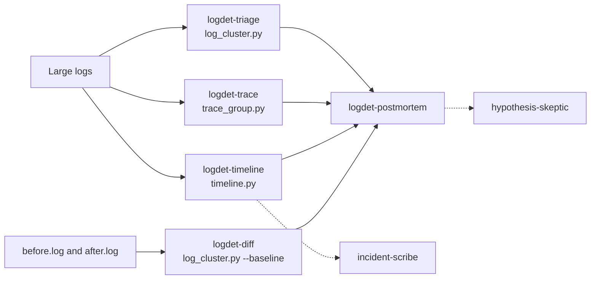

# log-detective-skill

**Don't read the logs. Interrogate them.**


Something broke in production and the evidence is a 2 GB log. Pasting it into a chat does not
work: it does not fit, it leaks customer data, and a model reading a million lines finds the
loudest one, not the first one. What you need to know is short: what broke, since when, and why.

This Claude Code pack answers that without the logs ever entering the conversation. Three
standard-library Python scripts stream the files and print only what matters: ranked failure
signatures with counts and rate over time, stack traces grouped by root cause and the first line
of your own code on the path, and one UTC timeline across services with the first bad line and
the error-rate spike marked. Five skills drive them, and two read-only agents check the work.

Everything runs locally. Memory use follows the number of distinct signatures, not the size of the
file (a generated 52 MB log with 500,000 records clustered in about 40 seconds, peaking near 35 MB of memory, on the development laptop).

## What's inside

| Skill | What it does |
|---|---|
| [`logdet-triage`](skills/logdet-triage/SKILL.md) | `log_cluster.py`: normalises every message to a signature, clusters, and reports level, count, first/last seen, a rate sparkline and one sample. `--redact`, `--since/--until`, `--level`. |
| [`logdet-trace`](skills/logdet-trace/SKILL.md) | `trace_group.py`: finds Python, Java/Kotlin, Node, Go and .NET traces, groups them by root-cause exception and top application frame, then maps that frame to your code. |
| [`logdet-timeline`](skills/logdet-timeline/SKILL.md) | `timeline.py`: merges logs of different formats and time zones into one UTC timeline around a moment, marks the first bad line and error-rate spikes. |
| [`logdet-diff`](skills/logdet-diff/SKILL.md) | `log_cluster.py --baseline`: before and after a deploy, or staging against production. New, vanished, spiking and quieter signatures. |
| [`logdet-postmortem`](skills/logdet-postmortem/SKILL.md) | No script. Writes a blameless post-mortem from the reports, every claim cited, owners left blank, five whys that stop where the evidence stops. |

| Agent | What it does |
|---|---|
| [`incident-scribe`](agents/incident-scribe.md) | Drafts timeline entries from the reports, each with its evidence, separating observed, inferred and reported. |
| [`hypothesis-skeptic`](agents/hypothesis-skeptic.md) | Takes a proposed root cause and lists what in the logs contradicts it or fails to support it. |

## Install

```
/plugin marketplace add vivekbhange-hub/log-detective-skill
/plugin install log-detective-skill@log-detective-skill
```

Manual install: copy `skills/*` into `~/.claude/skills/` and `agents/*` into `~/.claude/agents/`.

Requirements: Python 3.9 or newer. Nothing else.

## Try it in 60 seconds

The repo ships synthetic logs for a made-up shop, in [`examples/logs/`](examples/logs/): a web
service (JSON lines), a worker (Python logging, with chained tracebacks), Postgres, nginx access
logs written in `+0100` local time, and a Java payments service (Log4j, with "Caused by" traces),
plus a `before.log` and `after.log` pair. All data is fake: `example.com`, RFC 5737 addresses,
invented emails and a public test card number. In Claude Code:

> Triage the logs in examples/logs and tell me what happened around 14:03 UTC on 2026-11-12

Or run the scripts yourself from the repo root (on Windows use `python` instead of `python3`):

```
python3 skills/logdet-triage/log_cluster.py examples/logs/web.jsonl examples/logs/worker.log \
  examples/logs/db.log examples/logs/payments.log --level warning --top 8
```

Excerpt of the output, copied from [`examples/output/cluster.md`](examples/output/cluster.md):

```output
| # | Level | Count | First seen | Last seen | Rate | Signature |
|--:|---|--:|---|---|---|---|
| 1 | critical | 140 | 2026-11-12T14:03:00.140Z | 2026-11-12T14:09:28.243Z | `▁▁▁▁▁▁▁▁▁▁▁▁▁▅██████▇▁▁▁` | `sorry, too many clients already` |
| 2 | critical | 1 | 2026-11-12T14:02:57.390Z | 2026-11-12T14:02:57.390Z | `▁▁▁▁▁▁▁▁▁▁▁▁▁█▁▁▁▁▁▁▁▁▁▁` | `remaining connection slots are reserved for non-replication superuser connections` |
| 4 | error | 40 | 2026-11-12T14:02:57.430Z | 2026-11-12T14:09:27.256Z | `▁▁▁▁▁▁▁▁▁▁▁▁▁▅▇█▇▇█▇▇▁▁▁` | `shop.worker.inventory: inventory_sync failed for batch <n> [psycopg2.OperationalError]` |
```

1,562 log lines became 15 signatures at warning level or worse. Now the stack traces, grouped by what originally broke:

```
python3 skills/logdet-trace/trace_group.py examples/logs/worker.log examples/logs/payments.log \
  --app-prefix shop/ --app-prefix com.fernhill
```

```output
| # | Count | Exception | First seen | Last seen | Top application frame |
|--:|--:|---|---|---|---|
| 1 | 40 | `psycopg2.OperationalError` | 2026-11-12T14:02:57.430Z | 2026-11-12T14:09:27.256Z | `/app/shop/db.py:41` in `connect` |
| 2 | 4 | `java.net.SocketTimeoutException` | 2026-11-12T13:51:05.311Z | 2026-11-12T14:11:20.733Z | `GatewayClient.java:147` in `com.fernhill.payments.GatewayClient.post` |
```

The worker's traces surface as `DatabaseUnavailable`, but the root cause is the inner
`psycopg2.OperationalError`, and the group says so. Next, all five services on one clock:

```
python3 skills/logdet-timeline/timeline.py examples/logs/web.jsonl examples/logs/worker.log \
  examples/logs/db.log examples/logs/nginx-access.log examples/logs/payments.log \
  --around 2026-11-12T14:03:00Z --window 10m
```

```output
The earliest error-level signature in the window is `db:18` at 2026-11-12T14:02:57.390Z (not seen before the window).
| 2026-11-12T14:03:00Z | 2026-11-12T14:10:00Z | 37 | 454 | 147.6 |
2026-11-12T14:02:57.390Z  db            CRIT   remaining connection slots are reserved for non-replication superuser connections  [db.log:18]  <- first of its kind, new in window
2026-11-12T14:03:01.800Z  web           ERROR  checkout failed: psycopg2.OperationalError: connection to server at "db.example.com" (203.0.113.20), port 5432 failed: FATAL:  sorry, too many clients already (x131 until 14:09:34.999Z)  [web.jsonl:151]  <- first of its kind, new in window
2026-11-12T14:09:29.120Z  worker        WARN   shop.worker.inventory: 108 db connections still open at shutdown  [worker.log:796]
```

The payments timeouts that look scary are marked "seen before the window": background noise, not
the cause. The database ran out of connections, the web errors followed, and the worker's own
shutdown line says it held 108 of them. Finally, a deploy comparison:

```
python3 skills/logdet-triage/log_cluster.py examples/logs/after.log --baseline examples/logs/before.log --top 10
```

```output
- Versus baseline: 2 new, 1 spiking (rate x3 or more), 3 steady, 1 down, 1 vanished
| 1 | NEW | error | 14 | 0 | 2026-11-11T10:30:22.550Z | 2026-11-11T10:39:55.690Z | `█▁▁▅▁▁▁▁▅█▁▁█▁▁▁▁▅▅▁▅▁▅█` | `shop.api.tls: ssl handshake failed with upstream <ip>: certificate verify failed` |
| 3 | SPIKING (x14) | warning | 41 | 3 | 2026-11-11T10:30:21.533Z | 2026-11-11T10:39:23.498Z | `▄▅▄▄▅▁▃▃▄▄▄█▃▃▃▅▃▃▄▄▃▃▃▁` | `shop.api.cache: cache miss for key product:<n>` |
```

`python examples/regenerate.py --check` proves the committed outputs are exactly what the
scripts produce today.

## How it works



1. **Parse.** JSON lines (keys found automatically: `msg`/`message`/`event`, `level`/`severity`/
   `levelname`, `ts`/`time`/`@timestamp`, numeric pino levels), logfmt, syslog, nginx and Apache
   access logs (level from the status code), and text logs from Python logging, Log4j, Go and
   Node. Lines that continue a record (stack traces, wrapped messages) join the line before them.
   Timestamps in ISO-8601, RFC 3339, syslog, epoch seconds or milliseconds and Apache form become
   UTC; naive ones use `--tz`.
2. **Normalise.** Numbers, UUIDs, IPs, hex ids, paths, quoted values, timestamps, emails and
   tokens become placeholders, so `failed for order 1001` and `failed for order 99` are one
   signature. A root exception type found under the record is appended: `[psycopg2.OperationalError]`.
3. **Cluster, then compare.** Counts, first and last seen and a rate histogram per signature.
   With `--baseline`, per-minute rates are compared, and a signature is NEW, SPIKING (rate up by
   `--spike-factor`, default 3), DOWN or STEADY; signatures that are gone are listed as vanished.
4. **Group traces.** Root cause is the innermost exception of the chain: the first one printed by
   Python, the last `Caused by:` in Java, the inner `--->` exception in .NET. The grouping frame
   is the first one of yours, found by skipping `site-packages`, `node_modules`, `vendor/`,
   `java.*`, `jdk.*`, runtimes and anything outside your `--app-prefix` list.
5. **Order and flag.** The timeline folds repeats, marks the first occurrence of each error
   signature inside the window (new, or already seen before it), and flags error-rate spikes
   against a median and MAD baseline taken from outside the window.

The three scripts share one parsing core that is copied between them so each skill folder stays
self-contained. A test checks that the copies are identical.

## Responsible use

This pack is for logs you own or are authorized to analyse: your own services, systems you operate
for an employer or client, logs you have been given permission to examine.

- Logs often hold personal data and secrets. Use `--redact` whenever output will be quoted in a
  chat, a ticket or a post-mortem. It masks emails, tokens, JWTs, bearer headers, IPs and
  card-like numbers (13 to 19 digits that pass the Luhn check) in samples and signatures.
- Redaction is pattern based. It will miss a secret in a shape it does not know; review before you
  share a report outside your team.
- The skills tell the model not to read raw logs into the conversation and not to upload them.
  Nothing in this pack makes a network call.

## Principles and limits

- **Evidence over narrative.** Each skill ends in a hypothesis with a confidence and the check that
  would confirm or refute it. Order in time is not cause, and the post-mortem says "evidence ends
  here" instead of guessing.
- **Signatures are heuristics.** Quoted values collapse, so two different `KeyError: '<str>'` bugs
  share a cluster; a reworded message looks like one NEW and one vanished signature. Read the
  sample when a signature is too broad.
- **Levels can be inferred.** A line with no level word gets one from keywords such as "failed" or
  "refused". Inferred levels are flagged in the JSON. Integer levels follow the pino/bunyan scale
  (10 to 60), not Python's.
- **Whole-file context is not kept.** Streaming means one pass and bounded memory: at most
  `--max-clusters` signatures (default 5,000) and 400 continuation lines per record.
- **Pretty-printed multi-line JSON is not supported**; use JSON lines. Epoch timestamps are only
  recognised at the start of a text line or in a JSON time field.
- **Syslog has no year.** It defaults to this year; pass `--year` for older logs.
- **Spike detection is simple.** Median plus MAD (or mean and standard deviation) over buckets. It
  finds a step, not a slow drift, and needs a baseline of several quiet buckets.
- **Frames from containers keep deploy paths** (`/app/src/...`). Map them to your checkout by
  suffix; the skill does this, the script does not.
- **Platforms:** Python 3.9 or newer. The CI workflow runs the tests on Linux, Windows and macOS with Python 3.9, 3.12 and 3.13.

## Contributing

See [CONTRIBUTING.md](CONTRIBUTING.md). Run the tests with
`python -m unittest discover -s tests -v`.

## License

MIT © 2026 Vivek Bhange. See [LICENSE](LICENSE).
